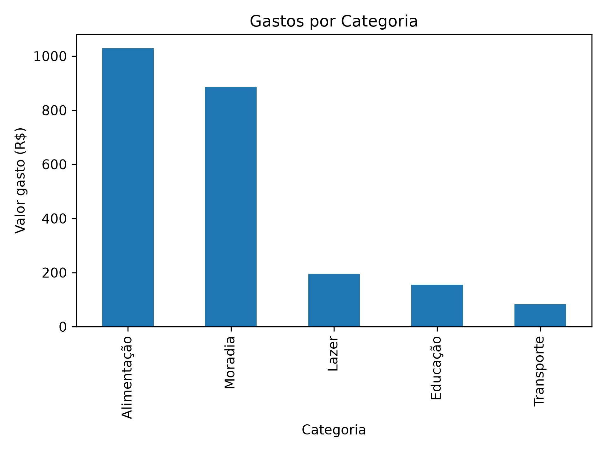
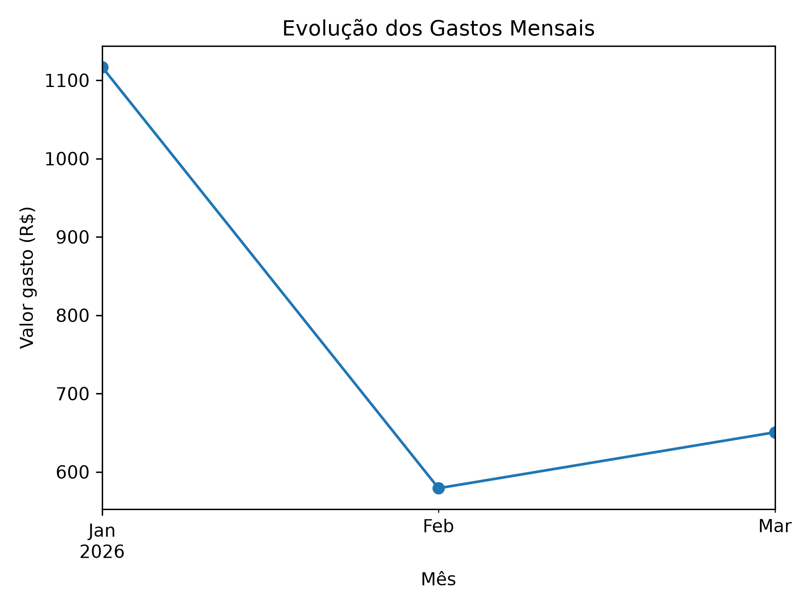
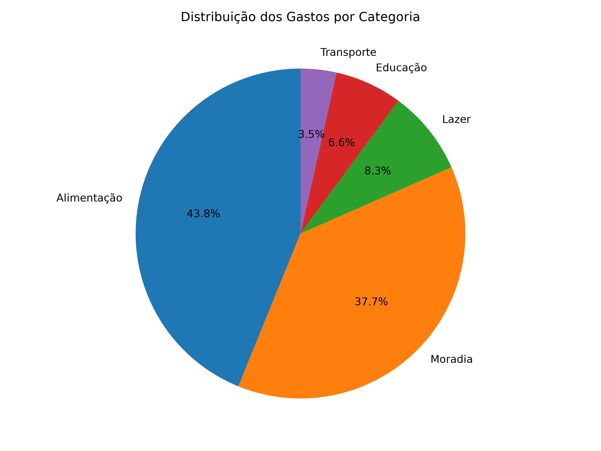

#  Análise de Gastos Pessoais

Projeto de análise de dados de gastos pessoais utilizando Python, Pandas e visualização de dados.

##  Objetivo

Analisar dados de despesas pessoais para identificar padrões de consumo, principais categorias de gastos e distribuição das despesas ao longo do tempo.

##  Tecnologias

- Python
- Pandas
- Matplotlib
- Jupyter Notebook

##  Estrutura do projeto

- `data/` — arquivos utilizados na análise
- `notebooks/` — análises exploratórias em Jupyter Notebook
- `src/` — código-fonte Python

##  Análises planejadas

- Total de gastos
- Gastos por categoria
- Gastos ao longo do tempo
- Identificação das maiores despesas
- Visualização dos dados por meio de gráficos

## Primeira versão funcional concluída, com análises estatísticas e vizualizaçãoes gráficas. Novas melhorias estão planejadas.

##  Funcionalidades implementadas

- Leitura e processamento de dados financeiros com Pandas
- Cálculo do total de gastos
- Análise de despesas por categoria
- Análise da evolução mensal dos gastos
- Identificação do mês com maior gasto
- Cálculo da média mensal de despesas
- Cálculo do percentual de gastos por categoria
- Visualização dos dados em gráficos

##  Visualizações dos dados

### Gastos por categoria

### Evolução dos gastos mensais

### Distribuição percentual dos gastos

